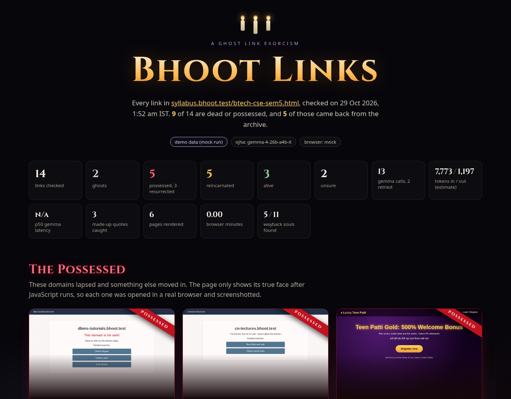
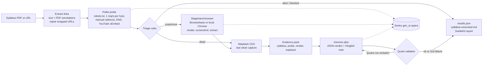
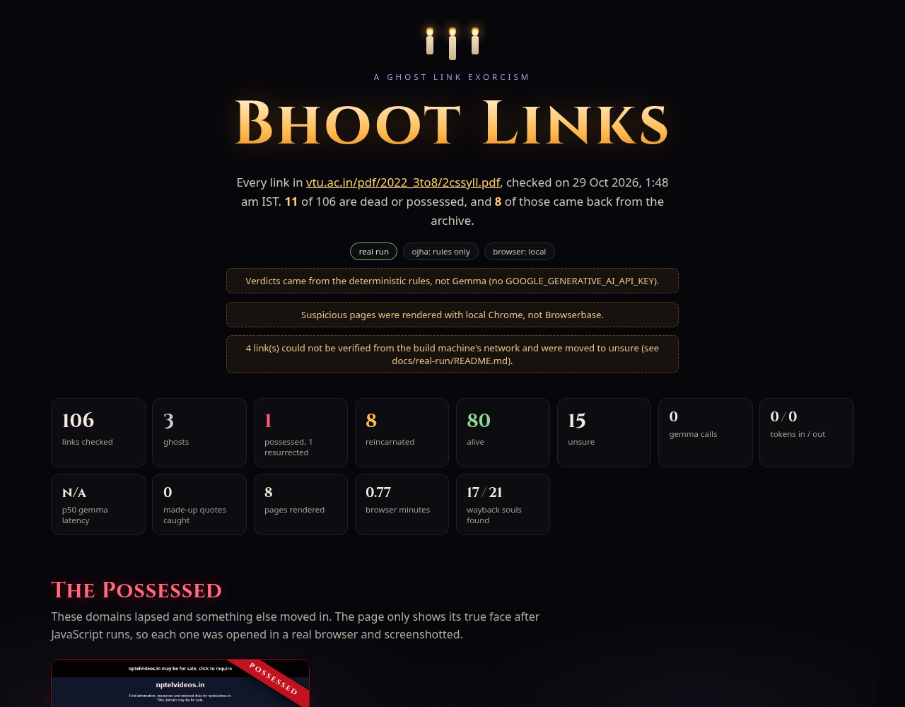

# Bhoot Links 👻

**Your syllabus links are haunted. Bhoot Links finds the ghosts, catches the possessed ones, and brings the dead back from the archive.**

Every Indian engineering syllabus ends each unit with "Web links and Video Lectures (e-Resources)". Somebody pasted those links years ago, the PDF got approved, and nobody ever clicked them again. Some now return 404. Some domains lapsed and were bought by parking companies or betting sites, so a first year student who clicks "Data Structures video lectures" lands on a page that says *this domain may be for sale*, or worse.

Bhoot Links reads a syllabus PDF or web page, checks every link, opens the suspicious ones in a real browser, asks an open-weight model (Gemma) to judge each one against evidence it cannot make up, and hands you:

* a haunted **report** (graveyard, possessed wall with screenshots, resurrections)
* `results.json` with every verdict, evidence quote and metric
* `syllabus-exorcised.md`, a copy of the syllabus with dead links replaced by their last clean Wayback Machine capture



*Screenshot of `npm run demo`. Demo data comes from a fake internet in `fixtures/`, not a real syllabus.*

## The five verdicts

| Verdict | Meaning |
| --- | --- |
| 🌿 **alive** | The page is there and is what the syllabus promised |
| 🪦 **ghost** | 404, 410, DNS failure, timeout, removed YouTube video. Gone, and no clean archive copy |
| 😈 **possessed** | The domain lapsed and now shows betting, casino, parked or spam content, or redirects to it |
| 🌼 **reincarnated** | Dead or possessed, but a clean Wayback Machine capture exists and is offered as the replacement |
| ❔ **unsure** | Bots blocked, login walls, or the model's claims failed validation. A human should look |

Every verdict carries a short Hinglish note from the **ojha** (the exorcist), because the people reading this report are students and faculty, not SREs.

## Quickstart

Needs Node 20+.

```bash
git clone https://github.com/AarishMansur/bhoot-links
cd bhoot-links
npm install
npm test
npm run demo          # zero keys, fake internet, builds the report
npm run preview       # open the report at http://localhost:4173
```

`npm run demo` starts a local fixture server that plays a small haunted internet (a 404, a 410, a 503, a DNS failure, a hanging server, two parked domains, a casino takeover, a JS-only casino redirect), scans a 14 link demo syllabus against it, and builds the report into `out/report/index.html`. The report is a single self-contained HTML file plus screenshots, so you can also just open it from disk.

Scan a real syllabus:

```bash
cp .env.example .env        # add the keys you have, all optional
npx bhoot scan https://vtu.ac.in/pdf/2022_3to8/2cssyll.pdf
npx bhoot scan ./my-syllabus.pdf --limit 40
npx bhoot report            # builds out/report from out/results.json
```

Flags: `--limit N` (first N links), `--no-render` (skip the browser), `--no-wayback`, `--out DIR`.

## How it works



1. **Extract.** `pdf-parse` gives page text and clickable link annotations. PDFs wrap long URLs across lines and glue the next word on, so the extractor repairs `watch?v=783KAB-⏎tuE4` and trims `watch?v=PqFKRqpHrjwFor loop`. HTML pages use cheerio, skipping nav and same-site links.
2. **Probe.** One GET per link with a real user agent, robots.txt respected, at most one request per second per host, bodies capped at 512 KB, redirects followed by hand so the whole chain is recorded. YouTube watch pages always answer 200, even for deleted videos, so YouTube links go to the keyless oEmbed endpoint instead.
3. **Triage.** Cheap deterministic rules sort links into alive, dead, blocked and suspicious. Suspicious means: parking host, betting or for-sale words, an off-domain redirect, a TLS mismatch, or a page with almost no text but plenty of script tags (the content, and often the casino, only appears after JavaScript).
4. **Render.** Only suspicious links are opened in a real browser with Stagehand: wait for load, read the visible text, take a screenshot, and (with a model key) run `extract()` with a zod schema asking whether this page is gambling, a casino, parked, or still about the topic.
5. **Wayback.** Dead and suspicious links are looked up in the CDX API. Captures are checked newest first and then stepping back in time, and a capture only counts if it has real text and none of the takeover signals, so a parked page archived last month is not offered as a resurrection.
6. **Judge.** Gemma gets an evidence pack and must answer in JSON with a status, evidence quotes, a resurrection URL and the ojha note. Then the validator checks it.
7. **Write.** `results.json`, `syllabus-exorcised.md`, and the report.

### The quote validator

An LLM that says "this page is a casino" without proof is just another ghost story. Every evidence quote Gemma returns must appear verbatim (case and whitespace normalised) in the source it names: the syllabus context, the probe, the rendered page, or the Wayback capture. A non-alive verdict needs at least one quote. A `reincarnated` verdict must use exactly the snapshot URL we found, and nothing else may invent a URL. If validation fails, Gemma gets one retry with the list of rejected claims. If it fails again, the verdict becomes `unsure` and the rejected claims are shown in the report. The demo includes one link that recovers on retry and one that ends up unsure, so you can see both paths.

## Why open models

The people who need this are college departments and students. They will not pay for an API, and syllabus PDFs plus whatever is on a lapsed domain are exactly the kind of content you may want to keep on your own hardware or a provider you choose. Gemma is open weights: the same model can be served from Google AI Studio's free tier today, from a college server tomorrow, or fine-tuned on Hinglish ojha notes later, without changing the prompt or the validator. The model's job here is narrow and checkable (classify, quote, write one line), which is where a mid-sized open model shines, and the validator means you do not have to trust it blindly.

## Partner technology

### Browserbase + Stagehand (the core)

The interesting links are the ones a plain HTTP check gets wrong. A lapsed domain often serves an almost empty HTML shell and then JavaScript paints the casino. Bhoot Links gives its agent a real browser for exactly those links:

* `@browserbasehq/stagehand` v3 drives the page: `page.goto`, `page.evaluate` for visible text, `page.screenshot` for the possessed wall.
* `stagehand.extract(instruction, zodSchema)` pulls a typed `PageVerdict` (title, topic, language, gambling, casino, parked, evidence lines) that the open model reasons over.
* With `BROWSER_PROVIDER=browserbase` it runs in a Browserbase cloud session; the session replay URL is printed and stored in `metrics.browserbaseSessionIds`, so every verdict can be audited.
* One session is reused for the whole scan. `MAX_BB_SESSIONS` and `MAX_RENDER_PAGES` are hard caps so a big syllabus cannot burn through free minutes. Browser minutes are tracked.
* `BROWSER_PROVIDER=local` runs the same Stagehand code against local Chrome, and works without any key.

It turns a one-off "click every link and squint" job into a repeatable workflow you can run every semester.

### Gemma (the ojha)

`gemma-4-26b-a4b-it` through Google AI Studio with the Vercel AI SDK (`ai` + `@ai-sdk/google`). Gemma is only called for dead and suspicious links; alive and blocked links get deterministic rule verdicts, which keeps the token bill tiny. Calls are spaced (`LLM_MIN_INTERVAL_MS`) to stay inside free tier limits, and `LLM_FALLBACK_MODEL` is used only if the main model errors. Without a key the whole pipeline still runs with rule verdicts and says so in the report.

### Sentry agent tracing (optional)

Set `SENTRY_DSN` and every scan becomes a trace: a `gen_ai.invoke_agent` root span, `gen_ai.execute_tool` spans for the browser render and Wayback lookups, and `gen_ai.chat` spans for each Gemma call with model, token counts and retries as attributes. The same numbers are printed at the end of every scan and shown in the report's metrics strip: tokens in and out, p50 Gemma latency, retries, rejected quotes, pages rendered, browser minutes.

## Configuration

Copy `.env.example` to `.env`. Everything is optional.

| Variable | Default | What it does |
| --- | --- | --- |
| `GOOGLE_GENERATIVE_AI_API_KEY` | none | Google AI Studio key for Gemma. Without it, rule verdicts |
| `LLM_MODEL` | `gemma-4-26b-a4b-it` | Model id |
| `LLM_FALLBACK_MODEL` | none | Used only when the main model call errors |
| `LLM_MIN_INTERVAL_MS` | `2500` | Gap between model calls |
| `BROWSER_PROVIDER` | `local` | `browserbase`, `local`, or `off` |
| `BROWSERBASE_API_KEY`, `BROWSERBASE_PROJECT_ID` | none | Browserbase credentials |
| `MAX_BB_SESSIONS` | `1` | Max browser sessions per scan |
| `MAX_RENDER_PAGES` | `25` | Max pages rendered per scan |
| `CHROME_PATH` | auto | Chrome binary for `local` |
| `SENTRY_DSN` | none | Turns on Sentry gen_ai tracing |
| `PROBE_TIMEOUT_MS` | `10000` | Per request timeout |
| `PER_HOST_DELAY_MS` | `1000` | Minimum gap between requests to one host |
| `PROBE_CONCURRENCY` | `6` | Links probed in parallel (different hosts) |
| `MAX_REDIRECTS` | `8` | Redirect hops followed |
| `HTTP_UPGRADE` | `0` | Try https first for http links |
| `DNS_RESOLVER` | `system` | `doh` uses DNS over HTTPS, for networks that fake DNS |
| `WAYBACK` | `1` | `0` skips the archive |
| `WAYBACK_MAX_CHECKS` | `4` | Captures inspected per link |
| `BHOOT_USER_AGENT` | `bhoot-links/0.1 (+repo url)` | Honest user agent |
| `OUT_DIR` | `out` | Where results go |
| `MOCK` | `0` | `1` uses fixtures for everything (what `npm run demo` does) |

## A real run

On 29 Oct 2026 I pointed it at VTU's official 2022 scheme CSE syllabus for 3rd and 4th semester ([PDF](https://vtu.ac.in/pdf/2022_3to8/2cssyll.pdf), 88 pages). From [`docs/real-run/`](docs/real-run/):

* **106** unique links, **80** alive
* **11** dead or possessed, and a clean Wayback copy was found for **8** of them
* **all 5** `nptel.ac.in` links 404
* **1** possessed domain: `nptelvideos.in` answers 200 OK and is now a parked "may be for sale" page; Bhoot Links stepped back past the parked captures to a clean copy from Feb 2021
* 54 YouTube links, 1 removed
* 15 unsure: bot walls, login-only course pages, and 4 links my build machine's network could not check fairly



That run used the keyless parts only (extract, probe, triage, Stagehand on local Chrome, Wayback, rule verdicts). The Browserbase and Gemma steps need keys; see [`docs/real-run/README.md`](docs/real-run/README.md) for the full table and caveats.

## Project layout

```
src/          CLI and pipeline (extract, probe, triage, render, wayback, ojha, metrics)
fixtures/     the fake haunted internet used by the demo and its screenshots
test/         vitest: PDF and HTML extraction, triage, robots, the quote validator, gzip
web/          SvelteKit static report, prerendered from results.json
docs/         screenshots and the real run
```

## Limitations

* **It is a sample, not a crawl.** Each link is fetched once. A site that is down for an hour looks dead for that hour; run it again before you email the HOD.
* **Bot walls are not ghosts.** 401, 403 and 429 answers, robots.txt disallows and login walls are reported as `unsure`, never as dead.
* **Keyword signals are crude.** Betting and parking words (English and some Hindi) catch the common takeovers. Without a model key, a well disguised spam page can slip through as alive, and an honest page about probability might get a second look.
* **Wayback is not always right.** "Clean" means real text and no takeover words, not "the right lecture". The snapshot is a suggestion for a human to accept.
* **YouTube** checks only say whether a video still exists, not whether it is the right video.
* **Free tiers.** Gemma on AI Studio and Browserbase free plans have rate and minute limits; the caps above exist for that.

## License

MIT, see [LICENSE](LICENSE).
